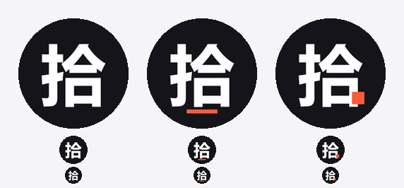

# 拾光手办 · 小程序注册信息

> 定稿版本，四项内容可直接复制填写。字符数按「一个中文等于 2 个字符」核算。

## 一、填写定稿

| 字段 | 填写内容 | 字符数 | 说明 |
| --- | --- | --- | --- |
| 小程序名称 | **拾光手办** | 8 / 30 ✓ | 四字，含搜索核心词「手办」 |
| 小程序简称 | **拾光** | 4 / 10 ✓ | 首选；若被占用改用「拾光手办」8/10 |
| 小程序头像 | `docs/brand/avatar-final-a.png` | — | 144×144 PNG，橙渐变底 + 白色手办剪影 |
| 小程序介绍 | 见下方推荐版 | 88 / 120 ✓ | 首句与名称呼应 |

### 介绍（推荐版）

> 拾起一段时光，做成一件手办。现货可直接下单，限量款按编号发售，也可提交需求定制专属角色。

## 二、名称的含义

「拾光」在这个业务里有三层同时成立的意思：

- **拾起时光** —— 手作的时间成本就是它的价值来源，一件作品花掉多少时间，买家看得到
- **拾** —— 拾取、收藏的动作，对收藏型买家是本能反应
- **一拾一格** —— 与限量编号的序号感呼应，每件作品都有它自己的位置

四字长度是刻意选的：2 到 3 个汉字重名概率极高，6 字以上在会话列表和搜索结果里会被截断，四字既能构成品牌词，又能在任何位置完整显示。

名称必须含「手办」二字。微信小程序的搜索权重里名称匹配远高于简介和服务类目，用户搜「手办」时，名称不含这两个字的根本不会被召回，简介写得再好也补不上这个缺口。

## 三、简称选择

简称只能从名称中连续截取，可选项只有三个：

| 候选简称 | 字符数 | 建议 |
| --- | --- | --- |
| 拾光 | 4 / 10 ✓ | **首选**。品牌词，简短，显示在会话列表角标处不占位 |
| 拾光手办 | 8 / 10 ✓ | 备选。「拾光」被其他小程序占用时使用 |
| 手办 | 4 / 10 ✓ | 品类词，过于通用，无法区分是你 |

简称同样全局唯一。先试「拾光」，提示已被占用就直接换「拾光手办」，不要为了凑短名字去改名称。

## 四、头像

使用 `brand/avatar-final-a.png`（墨黑底 + 白色「拾」字）。

**为什么是纯字而不是图形。** 这个头像迭代过四轮，前几版都走剪影路线（圆头 + 梯形身 + 台座，加过光晕、发梢、分色），结论是走不通：这类剪影在 40px 下会退化成通用 avatar icon，因为它的构成（对称圆形头部 + 简单身体）与任何 app 的用户占位图都无法区分。字形路线则相反——中文用户对汉字本身就有辨识能力，不需要依赖图形简化，小尺寸下反而更清楚。

**几个设计取舍：**

- 字高占画布 60%，四周留出圆形裁切安全区，头像被裁圆时不会切到笔画
- 中文字体按 em box 居时会偏上（下方预留了基线空间），所以视觉中线手动下移了 3px
- 只用黑白两色。加橙色点缀的三个变体都试过：底划会与「口」的下沿打架，方块会破坏「合」的撇捺结构，最终都放弃
- 一个字的品牌标识本来就该克制，「拾」的辨识度来自字形本身，不需要装饰

| 未采用的版本 | 文件 | 放弃原因 |
| --- | --- | --- |
| 字 + 橙色底划 | `brand/avatar-final-b.png` | 底划与「口」下沿过近，40px 下糊成一体 |
| 字 + 橙色方块 | `brand/avatar-final-c.png` | 方块破坏「合」的撇捺结构，字形显得脏 |
| 剪影（多版） | `brand/avatar-v3-*.png`、`avatar-v4-*.png` | 均无法脱离通用图标观感 |

调整字号或配色后重新生成：`python scripts/gen-avatar-final.py`

## 五、其他介绍版本

### 功能版（102 / 120 字符 ✓）

> 原创手办作品展示与定制。提供现货直购、限量编号发售、专属角色定制三种方式，每件作品单独制作并附编号卡。

### 品牌版（82 / 120 字符 ✓）

> 把喜欢的样子做成可以摆着的实物。现货、限量、定制三种购买方式，均由手作人单独完成。

## 六、审核注意

1. **避免极限词**：不要出现「第一」「最好」「唯一」「顶级」，广告法明确禁止。
2. **避免资质词**：不要写「平台」「官方」「旗舰」，容易触发平台类目或资质要求。
3. **避免承诺**：不要写「保证」「必出」「永久」，售后纠纷时会成为不利证据。
4. **头像避开第三方形象**：不用动漫角色、明星、知名 IP 的图，即便是自己手作的同人作品，头像层面也可能被判侵权。
5. **名称与业务一致**：名称、介绍、实际售卖内容需一致，否则类目审核会被驳回。

---

## 附录：备选名称

若「拾光手办」提示已被占用，按顺序尝试下列名称。简称均为名称的连续子串，可直接使用。

| 名称 | 字符数 | 简称 | 字符数 | 简称合规 |
| --- | --- | --- | --- | --- |
| 一格手办 | 8 / 30 ✓ | 一格 | 4 / 10 ✓ | 是 |
| 手办小馆 | 8 / 30 ✓ | 手办 | 4 / 10 ✓ | 是 |
| 手办工坊 | 8 / 30 ✓ | 手办 | 4 / 10 ✓ | 是 |
| 手办橱窗 | 8 / 30 ✓ | 手办 | 4 / 10 ✓ | 是 |

> 名称提交修改需重走审核，且有年度修改次数限制。若只是想让小程序尽快跑起来验证交易链路，建议先用定稿名，后续有真实订单后再考虑更名。
